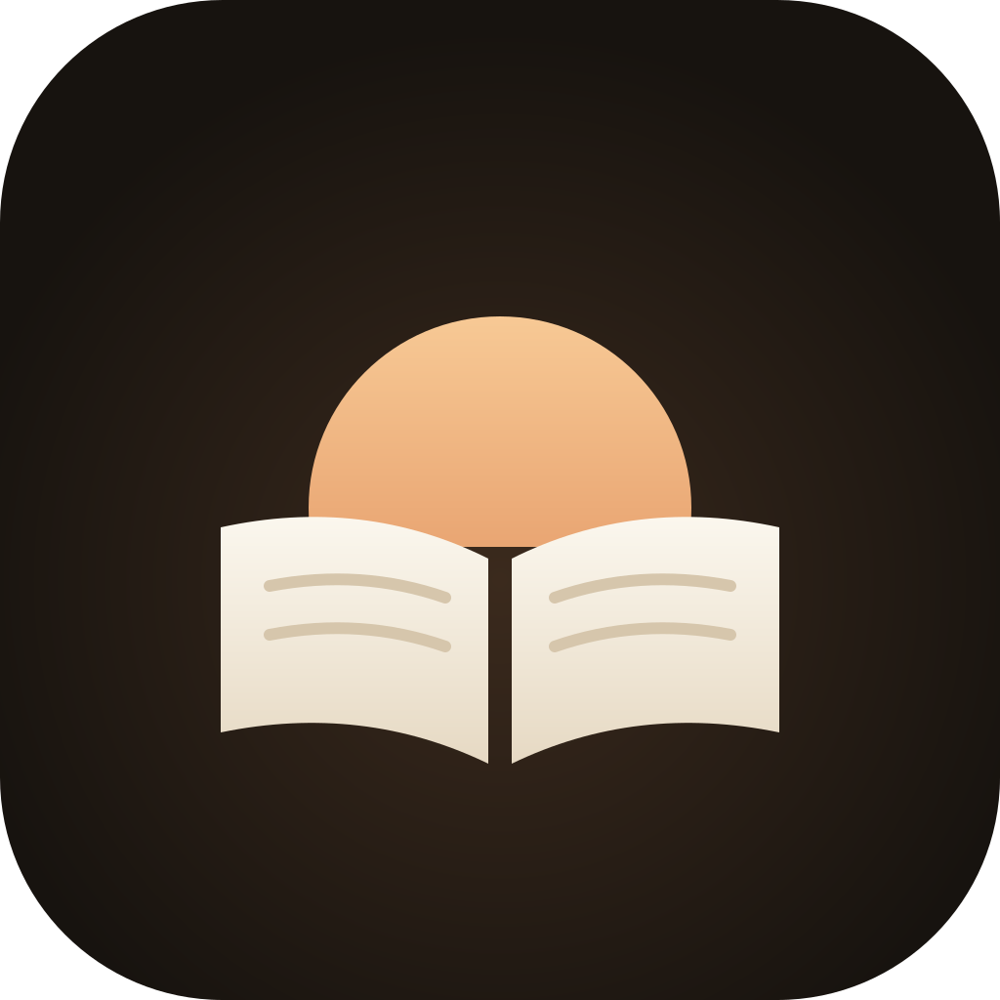

<div align="center">



### A calm reader for manga, comics, and light novels

_Your files and the sources of the community, in one warm app_

<p align="center">
  
  
</p>

<p align="center">
  <a href="https://github.com/Stiven-Gjekaj/Asabunko/releases/latest"></a>
  <a href="https://ko-fi.com/stivengjekaj"></a>
</p>

<p align="center">
  <a href="https://github.com/Stiven-Gjekaj/Asabunko/actions/workflows/ci.yml"></a>
  
</p>

</div>

---

## Overview

**Asabunko** is an iPhone and iPad app that reads manga, comics, and light
novels. "Asa" is the morning and "bunko" is a small paperback library in
Japanese. The app has a warm dark look and a paper look.

Version 0.1.0 reads the comic archives in your files. The next releases add
EPUB and PDF, OPDS servers, and the source lists of LNReader, Aidoku,
Paperback, and Suwayomi. See [TODO.md](TODO.md).

Asabunko has no sources in it. Your books stay on your device.

## Features

- Import CBZ, CBR, CB7, and CBT files, ZIP, RAR, 7z, and TAR archives, and
  folders of images from Files, or with "Open in Asabunko"
- The title, the writer, and the direction come from ComicInfo.xml
- Read from the right to the left, from the left to the right, or in one
  vertical column. Pinch or double tap to zoom
- A tap at the edge turns the page. A tap in the middle shows the bars
- Continue reading: the books that you read now, with the page and the
  progress
- Mark a book as read or as unread
- Warm dark, paper, or the look of the device
- The app tells you when a newer version is available

## Install

Asabunko is not in the App Store.

**With SideStore or AltStore:** add this source one time. The app then gets
each update from it.

```
https://stiven-gjekaj.github.io/sidestore-source/apps.json
```

**By hand:** each release has an unsigned `Asabunko.ipa`. Sign and install it
with one of these tools:

- [AltStore](https://altstore.io) or [SideStore](https://sidestore.io)
- [Sideloadly](https://sideloadly.io)
- [TrollStore](https://github.com/opa334/TrollStore), on a version of iOS
  that it supports

The newest IPA is always at this URL:

```
https://github.com/Stiven-Gjekaj/Asabunko/releases/latest/download/Asabunko.ipa
```

## Project structure

```
App/Sources/
  Model/        the app model, which keeps the library and imports the files
  Screens/      the library, the reader, and the settings
  Components/   the covers, the page loader, and the two readers
  Theme/        the warm colours and the font, from ZettaStream
AsaCore/        the parts that do not need a screen, with their tests
  Sources/CArchive/   the declarations of the libarchive of the system
  Sources/AsaCore/    the archives, the import, ComicInfo.xml, and the library
UITests/        the checks in the simulator
assets/brand/   the icon
docs/           the reason behind each choice
scripts/        the build of the IPA
project.yml     the XcodeGen project
```

## Building

You need Xcode 16 or newer and XcodeGen.

```
brew install xcodegen
git clone https://github.com/Stiven-Gjekaj/Asabunko
cd Asabunko
./scripts/build-ipa.sh
```

The IPA is in `build/`. To work in Xcode, run `xcodegen` and open
`Asabunko.xcodeproj`.

A tag such as `v0.1.0` makes the workflow build the IPA and attach it to a
release.

## Testing

```
swift test --package-path AsaCore
xcodebuild -project Asabunko.xcodeproj -scheme Asabunko -destination 'platform=iOS Simulator,name=iPhone 17' test
```

The unit tests make their own ZIP, 7z, and TAR archives with libarchive. They
cover the reader of the archives, the natural order of the pages,
ComicInfo.xml, the import, the cover, and the library file. The UI tests make
a CBZ, import it into an empty library, read it from the right to the left,
and change the look.

## Documentation

- [docs/decisions.md](docs/decisions.md): each choice and its reason
- [CHANGELOG.md](CHANGELOG.md): what changed, and when
- [TODO.md](TODO.md): the next releases
- [AGENTS.md](AGENTS.md): the rules for an agent that works here

## License

MIT. See [LICENSE](LICENSE). Karla is under the SIL Open Font License, in
[licenses/](licenses/Karla-OFL.txt). The app links the libarchive of the
system, under the BSD License.
